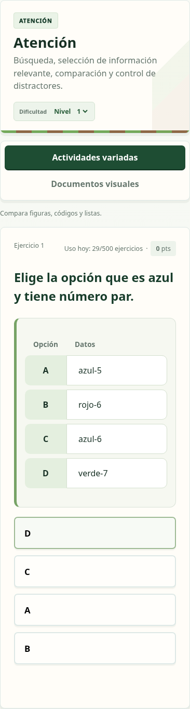

# Atención, Memoria, carga de retos y documentos visuales

La iteración conserva las mecánicas y el contenido validados de la beta. No introduce nuevos permisos, servicios ni cuotas.

## Cambios visibles

- Atención: las fuentes completas `A) … · B) … · C) … · D) …` se presentan en una tabla con las letras y los datos originales. Los botones pueden barajarse sin alterar su correspondencia. El mismo adaptador conserva los datos en las fichas. Los formatos incompletos no se reconstruyen ni se adivinan.
- Memoria: las etiquetas junto a los iconos omiten artículos iniciales («gato», «zanahoria», «llave inglesa»). Las preguntas, las respuestas guardadas y la evidencia original conservan su texto; no se cambia la corrección. Word usa etiquetas breves y conserva los nombres originales en los metadatos de las imágenes.
- Factura, recibo y catálogo: mejor jerarquía, columnas numéricas alineadas, filas separadas y bloques para totales, paquetes y condiciones. Las imágenes de pantalla y Word son las mismas. No se han modificado precios, fechas, condiciones, preguntas ni transcripciones.

[Atención en escritorio](review-assets/attention-speed-visuals/attention-desktop.png) · [Factura](../assets/documents/invoice-co-v1.png) · [Recibo](../assets/documents/receipt-co-v1.png) · [Catálogo](../assets/documents/catalogue-co-v1.png)

## Carga de Velocidad

La generación reutiliza los grupos de mecánicas del banco en lugar de volver a recorrerlo en cada intento. Los grupos se invalidan cuando cambian los proveedores de contenido. Cada candidato entregado sigue siendo una copia independiente.

La selección reutiliza las firmas de los candidatos y calcula el historial de documentos una sola vez por elección. Mantiene los 900 intentos, la validación, la rotación, la variedad y los controles de acceso y cuota. No anticipa solicitudes de pago ni guarda respuestas entre usuarios.

Medición local con `tests/edge-harness.js`, banco teen/Velocidad/nivel 1, variante internacional, 450 entradas de historial, un reto por solicitud, 12 solicitudes por versión, semilla idéntica. Comparación con el código de `45358c5`:

| Medida | Antes | Después |
| --- | ---: | ---: |
| Primera selección en el proceso | 995 ms | 497 ms |
| Mediana de las siguientes 11 | 247 ms | 159 ms |

Las 12 selecciones resultaron idénticas. Son tiempos de CPU/ejecución local; no incluyen red, base de datos real ni arranque de Supabase. La latencia real debe comprobarse tras publicar.

## Comprobación y publicación

- `npm test`: 142 pruebas superadas.
- `python -m unittest discover -s tests -p 'test_*.py'`: 9 pruebas superadas.
- Navegador: `browser-practice-documents-memory.py`, `browser-session-layout.py` y `browser-documents.py` superados.

Se han comprobado la tabla A–D y su corrección en navegador de escritorio/móvil, etiquetas sin artículos, revelado de Memoria, sesiones de cinco edades y la posición estable de los botones de Velocidad. Los DOCX se generan con las bibliotecas reales, incluyendo ZIP y los 18 PNG originales. El generador de documentos comprueba límites de texto y de columnas antes de escribir las imágenes. No hay Microsoft Word instalado para comprobar su paginación final.

Crear una PR desde `improve/attention-speed-visuals` hacia `desarrollo`. Esperar la comprobación automática y revisar la vista de Cloudflare de la rama. Tras fusionar, esperar el éxito de la publicación de beta y abrir `https://pruebas.learning-hub-5n9.pages.dev`. Si la pestaña conserva la versión anterior, recargar con Ctrl+F5. La mejora del selector requiere también que termine correctamente la publicación de la función de Supabase.
