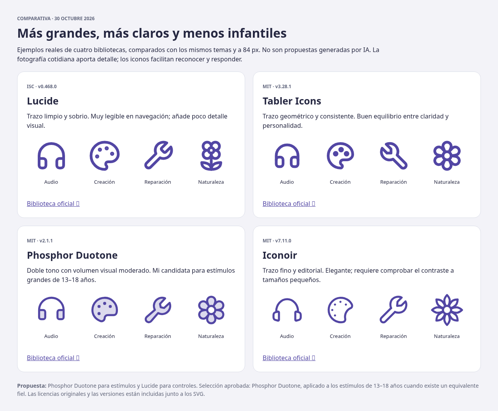
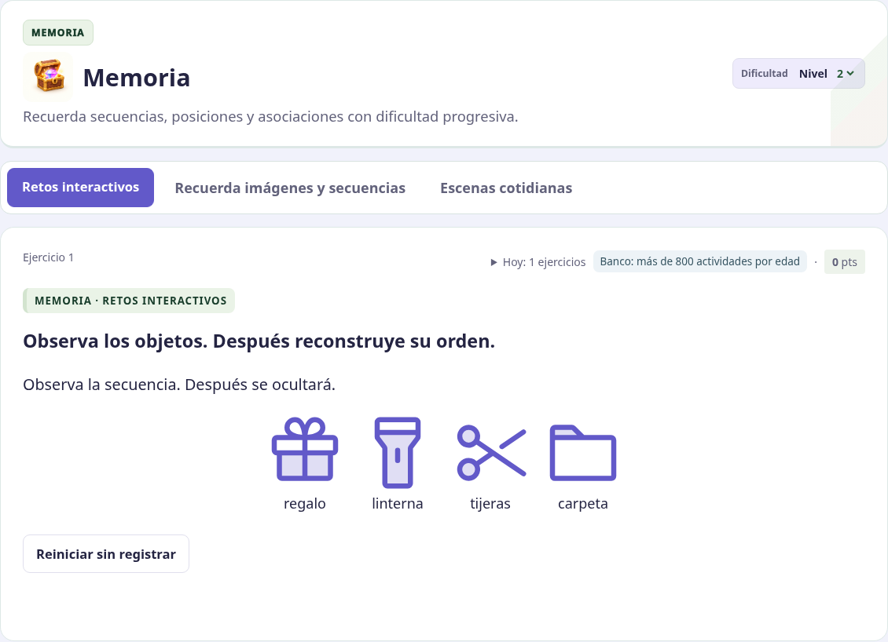
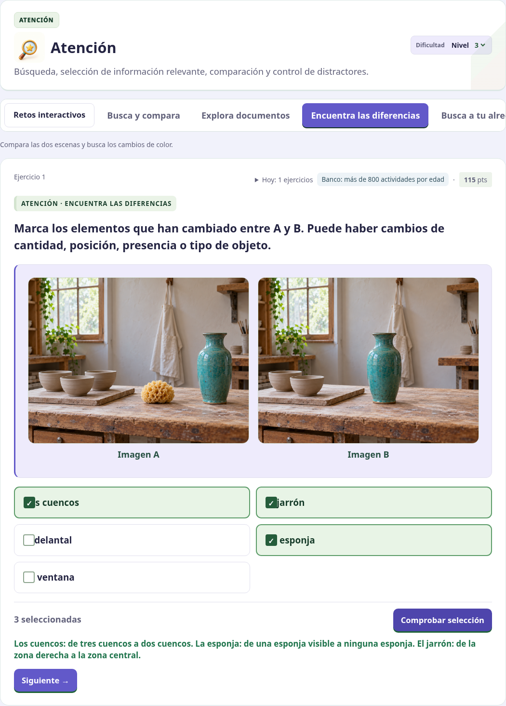
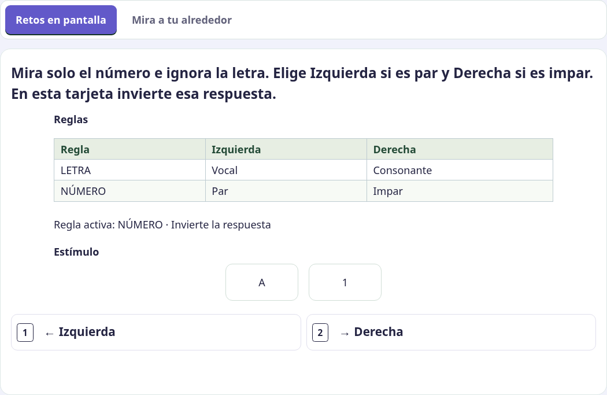
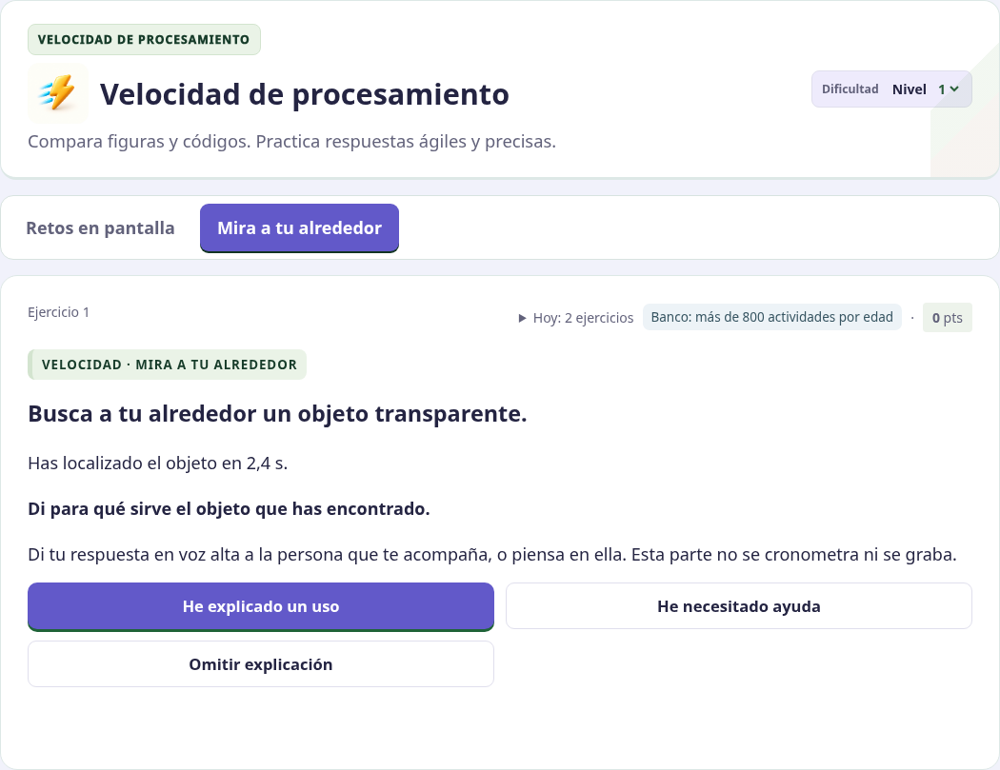
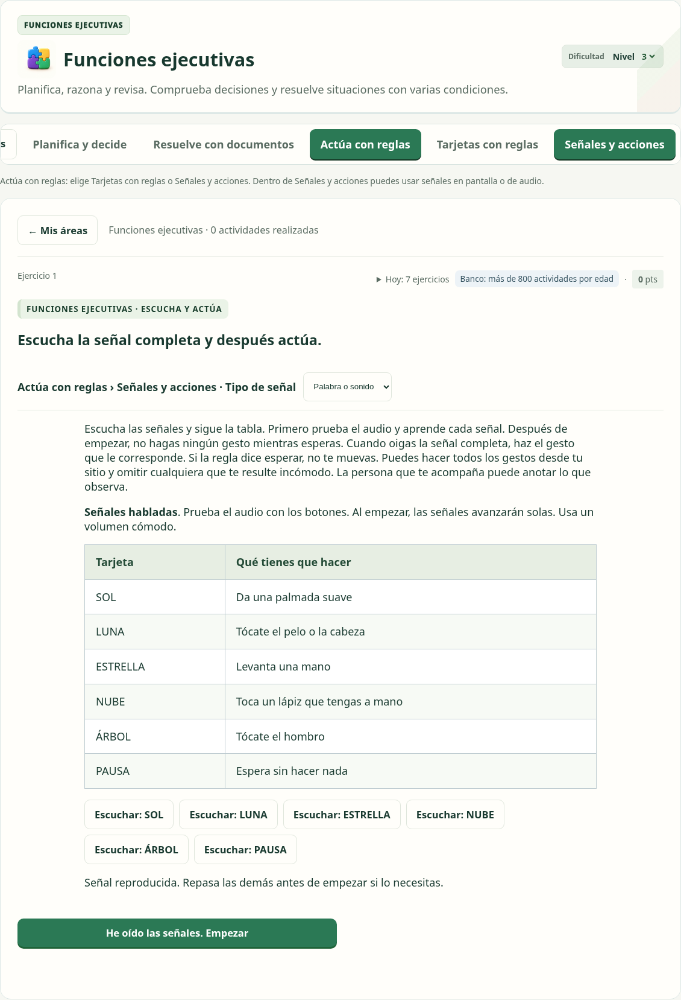

# Variedad visual, instrucciones y señales — 30/10/2026

Esta revisión responde al feedback posterior a la fusión de la PR 24. No presenta esta iteración como cierre de toda la fase 2.

## Bibliotecas revisadas y elección aplicada

Se compararon 16 SVG oficiales, con temas equivalentes y la misma escala, de cuatro bibliotecas: Lucide (ISC, con referencia a la herencia Feather/MIT), Tabler (MIT), Phosphor Duotone (MIT) e Iconoir (MIT). Las versiones, fuentes, muestras y licencias están en [la comparativa](../../assets/icon-library-review-20261030/index.html); también se incluye [un ZIP descargable](../../assets/icon-library-review-20261030/comparativa-iconos.zip). Son bibliotecas de iconos vectoriales; las fotografías cotidianas se generan aparte. Esta revisión no afirma haber auditado sus catálogos completos.

El usuario eligió **Phosphor Duotone**. Se integran 74 equivalentes fieles para 13–18 años, con el mismo SVG en pantalla y PNG rasterizado del original en Word. No hay descargas externas de iconos durante el ejercicio. La elección de estilo de una ficha depende de su franja, no del perfil abierto en pantalla. Los estados específicos y los objetos sin equivalente fiel mantienen su dibujo revisado; no se sustituye, por ejemplo, una botella abierta por otra cerrada ni se borra el color de un globo que forme parte de la respuesta.

Los estímulos de las secuencias se amplían a 104 px en escritorio y 80 px en móvil; las opciones, a 88/68 px. Las casillas densas mantienen límites que evitan el desbordamiento. En Word los pictogramas de adolescentes pasan de 32 a 48 px. Las edades menores mantienen Calma y los pictogramas previos. Las secuencias y cuadrículas de adolescentes alternan herramientas, orientación, música y creación en lugar de reutilizar siempre los seis objetos escolares. No se han cambiado los iconos de navegación en 3D ni los documentos visuales existentes.

## Seis fotografías nuevas y hechos revisados

Se generaron cuatro escenas base: cerámica, creación musical, reparación de bicicletas e invernadero. No incorporan las mochilas, botellas, pelotas, gafas o libros que motivaron el feedback. Se añadieron dos variantes B, de cerámica y música, para formar pares reales de diferencias. Los seis PNG originales están en [el repositorio de escenas](../../assets/photos/everyday-variety-20261030/).

Cada escena base tiene seis preguntas simples revisadas visualmente y preguntas de dos/tres hechos combinados en L2/L3. Cuando hay material secundario al fondo, la pregunta delimita el primer plano. La cerámica pasa de tres a dos cuencos, pierde la esponja y desplaza el jarrón al centro; la música pierde el micrófono, mueve la maraca al otro lado de los auriculares y desplaza estos a la derecha. Se mantienen las imágenes anteriores.

Los dos pares nuevos usan selección mediante botones: un objeto que ya no aparece en B no recibe un rectángulo invisible engañoso. No se afirma que los archivos generados sean idénticos píxel a píxel fuera de los cambios señalados; los ejercicios preguntan por los cambios concretos inspeccionados.

## Regla activa en velocidad

El enunciado dice expresamente qué dato mirar y cuál ignorar. Si la regla es LETRA, se clasifica la letra como vocal o consonante; si es NÚMERO, se clasifica el número como par o impar. L3 indica cuándo invertir la respuesta. El feedback explica el caso concreto.

Las opciones dejan de barajarse en esta mecánica: **Izquierda se sitúa a la izquierda y Derecha a la derecha**, con flechas. Se conservan la respuesta factual, las otras mecánicas y los atajos numéricos correspondientes a la posición visible.

## Buscar y explicar una utilidad

En «Mira a tu alrededor» la búsqueda termina al localizar el objeto. Después se pregunta por su utilidad: L1 pide un uso; L2 una acción concreta; L3 un uso habitual y otro posible. La explicación no se cronometra y no se captura voz, imagen ni texto. Se guarda únicamente la observación declarada: explicado, con ayuda u omitido, separada del tiempo de búsqueda y de los aciertos de pantalla. No se afirma comprobar automáticamente ni el objeto ni la explicación. La ficha Word también conserva esta segunda consigna.

## Jerarquía y fusión de señales

**Actúa con reglas** es la categoría superior. Sus dos opciones son **Tarjetas con reglas** y **Señales y acciones**. Esta última reúne las antiguas «Espera y actúa» y «Escucha y actúa». Dentro del mismo ejercicio se elige el tipo de señal: **En pantalla** o **Palabra o sonido**. No hay dos botones superiores para estas variantes. Las señales de voz/tonos mantienen prueba de audio explícita, avance automático, interrupción y observación sin puntuación de gestos. Los registros antiguos se conservan y se muestran con nombres coherentes con la nueva agrupación.

## Compatibilidad y validación

El frontend usa revisión 10. Los clientes almacenados en caché no reciben los nuevos identificadores fotográficos, y las búsquedas con la segunda consigna y los retos ejecutados revisados requieren actualizar la página. El workflow sigue publicando primero el backend y después la web. No se han alterado cuotas, suscripciones, tablas ni la separación entre sesión independiente y seguimiento.

La validación comprueba la selección de biblioteca por edad, PNG fieles y legibles, las seis imágenes y sus dimensiones, hechos y distractores, las respuestas de la regla activa, el orden visible de los botones, la explicación fuera del cronómetro, compatibilidad de clientes, los flujos de voz/tonos y la exportación Word con los mismos pictogramas. Las capturas usan perfiles ficticios y backend local; no acreditan un despliegue remoto.

Resultado local: **224 pruebas Node, nueve Python y 16 recorridos de navegador correctos**. Tras añadir los pares y los últimos ajustes de estilo se repitieron los recorridos afectados: fotografías, retos ejecutados/Word, señales de voz/tonos y velocidad con explicación del uso.
