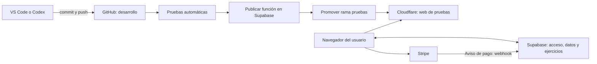

# Guía de funcionamiento y actualización de Learning Hub

Actualizada: 17 de octubre de 2026. Para la persona propietaria y quien mantenga la plataforma desde VS Code.

## 1. Qué hace cada servicio

| Servicio | Qué contiene o hace | Qué NO hace por sí solo |
| --- | --- | --- |
| GitHub | Guarda el código y su historial. GitHub Actions puede ejecutar pruebas y publicaciones. | Guardar un archivo no lo publica en Supabase. |
| Cloudflare Pages | Entrega la web, estilos, imágenes y código del navegador. Publica desde las ramas conectadas a GitHub. | No actualiza la función de Supabase. |
| Supabase Auth | Identifica usuarios y mantiene sus sesiones y contraseñas. | No necesita el token de publicación para que alguien entre. |
| Supabase Database | Conserva cuentas, perfiles, progreso y resultados. | Subir código a GitHub no cambia las tablas. |
| Supabase Edge Functions | Selecciona ejercicios y comprueba acceso y cuotas. También recibe el aviso de Stripe mediante otra función. | La web no sustituye automáticamente este código. |
| Stripe | Cobra y gestiona suscripciones. Su webhook comunica el resultado a Supabase. | Crear un pago no debe dar acceso hasta que el servidor confirme su resultado. |
| Codex o VS Code | Son herramientas para trabajar sobre el proyecto. | No son necesarias para que los usuarios utilicen la web publicada. |



El navegador necesita Internet para comunicarse con Cloudflare y Supabase, y con Stripe cuando haya un pago. Tu ordenador no tiene que permanecer encendido. GitHub y el token de publicación intervienen al actualizar el proyecto, no en cada uso de Elena.

## 2. Tokens: qué caduca y qué sigue funcionando

Un token es una credencial que permite a un programa realizar determinadas operaciones. No es la cuenta de un alumno ni la contraseña de Elena.

| Credencial | Dónde se utiliza | Si se revoca o cambia |
| --- | --- | --- |
| Publishable key de Supabase | En `js/config.js`, dentro de la web pública. Los datos siguen protegidos por los permisos del usuario y las reglas de la base de datos. | La web debe recibir la clave nueva para seguir conectándose. |
| `SUPABASE_SERVICE_ROLE_KEY` | Solo en un entorno administrativo seguro. Se utilizó para crear el acceso de la revisora. | Las tareas administrativas que la usen dejarán de funcionar. No debe publicarse dentro de la web. |
| `SUPABASE_ACCESS_TOKEN` | En los secretos de GitHub Actions y, si se trabaja con Codex, en los secretos de ese entorno. Permite publicar Edge Functions en el proyecto autorizado. | No se podrán publicar cambios con ese token. La versión ya publicada y los usuarios siguen funcionando. |
| Contraseña de Elena | Solo Elena y Supabase Auth. | Elena puede cambiarla o recuperarla; no depende del token de despliegue. |

No hace falta un token permanente. Para mantenimiento se recomienda uno dedicado a publicaciones, con los permisos mínimos y una vigencia que permita revisarlo y renovarlo (por ejemplo, 90 días si Supabase ofrece esa opción). Puede revocarse antes. Una duración mayor reduce renovaciones, pero también prolonga el tiempo durante el que podría utilizarse si se expusiera.

El token actual se creó con 7 días. Renovarlo NO exige cambiar contraseñas de usuarios, migrar datos ni reiniciar la plataforma. No lo confundas con las sesiones de usuario, que Supabase gestiona y renueva mediante su propio sistema.

### Renovar el token

1. Supabase → cuenta → Access Tokens → Generate new token.
2. Nombre reconocible, por ejemplo `GitHub Learning Hub beta`. Limitar al proyecto Learning_Hub y a **Edge Functions: Read-write**.
3. GitHub → repositorio `massegu/learning-hub` → Settings → Secrets and variables → Actions → Secrets. Actualizar `SUPABASE_ACCESS_TOKEN`.
4. Si Codex también lo utiliza, actualizar su secreto del mismo nombre, dominio `api.supabase.com`, y aplicar/publicar la configuración del entorno.
5. Ejecutar de nuevo el flujo de GitHub y comprobar el resultado. Después se puede revocar el token sustituido.

**Los secretos de Codex y los de GitHub son dos almacenes diferentes. Guardarlo en uno no lo guarda en el otro.** No guardes estas claves en el repositorio, los archivos de la web, capturas ni mensajes. El secreto `service_role` no es necesario para el flujo automático de publicación.

## 3. Local, pruebas y uso habitual

- `localhost:8001` es el ordenador donde ejecutas la web. Elena no puede entrar desde su equipo con esa dirección.
- `python3 tools/review-preview.py` utiliza la web y el generador real con cuentas/datos ficticios. Sirve para revisar contenido sin gastar cuotas reales. Se necesitan Node 24 y Python 3.
- `python3 -m http.server 8001 --bind 127.0.0.1` solo sirve los archivos: la web continúa conectándose al Supabase indicado en `js/config.js`. Por tanto, puede utilizar cuentas y datos reales aunque esté en local.
- La versión de pruebas se abre desde Internet. La dirección estable prevista es **https://pruebas.learning-hub-5n9.pages.dev**. Debe compartirse cuando Cloudflare haya terminado de publicarla y esté comprobada.
- Un enlace como `1291ae1d.learning-hub-5n9.pages.dev` corresponde a un despliegue concreto. No irá mostrando las versiones siguientes. Sirve para revisar exactamente aquella versión.
- La rama `beta-downloads` contiene archivos descargables, no la aplicación. No uses su enlace de Cloudflare para entrar a la plataforma.

Actualmente las webs de pruebas y habitual apuntan al MISMO proyecto Supabase: `duvdwsbzrivtxgeqvsln`. Esto significa que publicar una función afecta a ambas. La automatización ordena los pasos, pero no convierte los servicios en una operación única ni aísla los datos. Antes de tener usuarios de pago y probar cambios incompatibles, conviene disponer de otro proyecto Supabase de pruebas; habrá que preparar su estructura, cuentas y configuración. No se ha creado ese segundo proyecto.

## 4. Ramas y publicación preparada

| Rama | Para qué sirve | Qué debes hacer |
| --- | --- | --- |
| `desarrollo` | Trabajo diario y entrada al flujo automático de beta. | Hacer aquí commit y push cuando hayas revisado los cambios locales. |
| `pruebas` | Código promovido después de las comprobaciones y la función. Cloudflare publica esta rama. | No editarla ni subirle cambios directamente en el trabajo habitual. |
| `main` | Sitio habitual de Cloudflare. | No fusionar cambios aquí hasta decidir una salida al uso habitual. |
| `fix/early-primary-stimulus-integrity` | Rama donde se preparó la revisión inicial. | Conserva el historial. El trabajo nuevo se organizará en desarrollo. |

El flujo `.github/workflows/publicar-beta.yml`:

1. Comprueba las actividades y fichas con `npm test`, las herramientas de despliegue y la interfaz de contraseñas.
2. Comprueba que no se intenta publicar una revisión anterior o divergente respecto a `pruebas`.
3. Comprueba que el proyecto de Supabase coincide con el configurado en la web y compila la función sin sustituir todavía la versión activa.
4. Guarda una copia de la función anterior y publica la nueva, conservando la verificación de acceso JWT.
5. Solo después promueve ese mismo código a `pruebas`.
6. Espera a Cloudflare y compara los archivos servidos con los archivos del repositorio.
7. Muestra en GitHub Actions el resultado y el enlace estable. Las copias del servidor se guardan como artefactos de esa ejecución durante 14 días.

Si falla una prueba o el acceso a Supabase, no se promueve la web. Si falla Cloudflare después de publicar Supabase, el servidor ya puede estar actualizado: no interpretes el fallo como una reversión automática de los dos servicios. Consulta el paso concreto y las copias.

La automatización solo publica `request-learning-content`. No despliega `stripe-webhook`, cambia tablas, configura correos ni activa pagos. Esas operaciones requieren su propia revisión.

### Configuración inicial que debe terminar la persona propietaria

En GitHub → Settings → Secrets and variables → Actions:

- **Secret:** `SUPABASE_ACCESS_TOKEN`, con el token dedicado.
- **Variable:** `SUPABASE_PROJECT_REF_BETA` = `duvdwsbzrivtxgeqvsln` mientras se utilice este proyecto compartido.

El flujo usa un entorno de GitHub llamado `beta`. Si habilitas aprobaciones en ese entorno, la publicación esperará esa aprobación; es opcional para esta beta. El permiso automático `GITHUB_TOKEN` necesita poder escribir la rama `pruebas`. Si una política de la organización lo impide, el paso de promoción lo indicará; no añadas un token personal de permisos generales para sortearlo.

En Cloudflare, el proyecto `learning-hub` debe seguir conectado a este repositorio y permitir despliegues Preview de `pruebas`. Ya existen previews de otras ramas, pero hay que comprobar la nueva dirección cuando se cree. No hace falta cargar un ZIP para las actualizaciones normales.

**El flujo no está operativo hasta guardar el secreto y la variable en GitHub y verificar una ejecución completa.** La comprobación diaria del token (`comprobar-token.yml`) solo se programa cuando ese archivo esté en la rama predeterminada de GitHub; mientras esté únicamente en las ramas de beta, puede ejecutarse manualmente. Cada publicación también comprueba el acceso. La comprobación diaria no renueva tokens automáticamente.

## 5. Trabajo habitual desde VS Code

Una vez clonada la carpeta, abre la terminal de VS Code en ella. No ejecutes los comandos desde otra carpeta.

### Antes de cambiar archivos

```sh
git status
git switch desarrollo
git pull --ff-only origin desarrollo
```

Si hay cambios locales sin guardar o Git informa de un conflicto, detente y revisa esos archivos. No uses `reset --hard` ni fuerces una subida para quitar el aviso.

### Editar y probar

```sh
npm ci --ignore-scripts
npm test
python3 -m unittest discover -s tests -p 'test_*.py'
python3 tools/review-preview.py
```

En Windows puede utilizarse `py` en lugar de `python3`. La prueba de navegador de contraseñas necesita Python Playwright y Chromium; el flujo automático los instala. La revisión local de ejercicios utiliza perfiles ficticios. Cierra ese servidor con Ctrl+C cuando acabes.

Algunos módulos se comparten entre la web y Supabase (`locale-content.js`, `document-library.js`, `reading-library.js`, `curriculum.js`). Sus copias en `js/` y `supabase/functions/request-learning-content/` deben coincidir. Los tests detectan diferencias.

### Guardar y subir

```sh
git diff
git add RUTAS_DE_LOS_ARCHIVOS_QUE_HAS_REVISADO
git commit -m "Describe el cambio concreto"
git push origin desarrollo
```

Sustituye `RUTAS_DE_LOS_ARCHIVOS_QUE_HAS_REVISADO` por las rutas reales; no es un comando literal para pegar. Revisa qué incluyes para no subir claves, resultados privados ni archivos ajenos al cambio.

### Confirmar la actualización

1. GitHub → Actions → **Comprobar y publicar beta** → ejecución correspondiente a tu commit.
2. Revisa los dos trabajos, `comprobar` y `publicar`. El primero en verde no demuestra por sí solo que se haya publicado nada.
3. Comprueba que el paso «Confirmar el enlace de Cloudflare» terminó correctamente.
4. Abre la dirección estable de pruebas y comprueba acceso, un ejercicio, progreso y una ficha.
5. Comparte el enlace con Elena. Su cuenta y progreso se mantienen al publicar código nuevo.

Una actualización puede tardar varios minutos. No ejecutes varios despliegues manuales mientras el flujo está trabajando. No hagas cambios directos en el editor de Supabase y esperes que vuelvan a GitHub: ese camino no sincroniza el repositorio.

## 6. Contraseña de Elena y recuperación

La nueva interfaz incluye:

- **Cambiar contraseña**, junto a «Salir», después de iniciar sesión. No envía correos ni requiere el token administrativo.
- **He olvidado mi contraseña**, en el acceso. Se escribe el correo y se solicita el enlace; al abrirlo se elige y confirma una contraseña nueva.

El cambio autenticado se ha probado con una cuenta técnica real, incluida la comprobación de que la contraseña anterior deja de funcionar. La contraseña de Elena no se ha cambiado en estas pruebas.

### Preparar el correo de recuperación en Supabase

1. Supabase → Authentication → URL Configuration.
2. Configurar la dirección principal del sitio y añadir a Redirect URLs los destinos que se utilizarán. Para beta: `https://pruebas.learning-hub-5n9.pages.dev/**`. Para pruebas locales, si se necesitan: `http://localhost:8001/**`.
3. La web genera un destino de recuperación en su propio origen con `?recuperar=1`; no acepta una dirección externa enviada por el usuario.
4. Revisar el envío de correos de Supabase. El servicio integrado puede limitar destinatarios y frecuencia. Para usuarios externos puede ser necesario configurar un proveedor SMTP propio en Authentication; no basta con añadir el botón a la web.
5. Pedir una recuperación desde la web con una cuenta técnica y comprobar que el correo llega, que el enlace abre la web correcta y que permite entrar con la contraseña nueva. Esto envía un correo real y debe hacerse cuando esté configurado el proveedor.

El token disponible para este trabajo solo permite gestionar Edge Functions; no permite modificar URL Configuration ni SMTP. La interfaz y las pruebas simuladas no acreditan por sí solas la entrega de correos. Hasta completar esta configuración, Elena puede entrar con su contraseña actual y cambiarla desde dentro.

## 7. Si algo falla

| Situación | Qué significa y qué hacer |
| --- | --- |
| Token de publicación caducado | Renueva el secreto en GitHub y repite la ejecución. No borres cuentas ni datos. |
| Falla `npm test` | El código no supera una comprobación. Corrígelo; no omitas la prueba para publicar. |
| Supabase funciona pero Cloudflare falla | El servidor puede estar actualizado y la web anterior. Revisa la ejecución antes de reintentar o restaurar. |
| Solo ves una versión antigua | Comprueba que has abierto `pruebas…`, no un enlace inmutable de una revisión antigua. Recarga el navegador. |
| No llega el correo de recuperación | Revisa destinatarios permitidos, límites, SMTP, carpeta no deseada y Redirect URLs. No cambies permisos de la base de datos para solucionarlo. |
| Se ha perdido un secreto | Sustitúyelo en su almacén seguro. Nunca lo recuperes pegándolo en un archivo público. |

### Volver a una versión anterior

Para el código de una mejora defectuosa, lo habitual es usar `git revert` en `desarrollo` y volver a ejecutar el flujo: crea una corrección nueva conservando el historial. No basta con hacer rollback solo de Cloudflare si también cambió la función.

Para una recuperación técnica del servidor, descarga la copia `.eszip` y su `.json` desde los artefactos de la ejecución de GitHub. Desde un entorno con `SUPABASE_ACCESS_TOKEN` configurado de forma segura:

```sh
python3 scripts/deploy-supabase.py --restore RUTA_DE_LA_COPIA.eszip --project-ref duvdwsbzrivtxgeqvsln
```

Es un ejemplo: sustituye la ruta y revisa la versión a restaurar. La herramienta comprueba el proyecto, la función y la integridad de la copia antes de enviarla. No desactiva la verificación JWT. Este camino de restauración se ha probado sin red; no se ha provocado un rollback real solo para probarlo.

La copia de una función NO es una copia de la base de datos. Los cambios en tablas deben prepararse mediante migraciones con su propio respaldo y procedimiento. Esta automatización no los aplica.

## 8. Antes de pasar de beta a pagos reales

Terminar el feedback de Elena, comprobar el circuito de correos y recuperación, decidir la separación de Supabase de pruebas y uso habitual, y verificar Stripe real con sus webhooks y cambios de acceso. Las mejoras semanales pueden continuar después. No se ha activado Stripe real ni se ha convertido esta beta en un lanzamiento de pago.

## 9. Diagnosticar la comprobación de Cloudflare sin publicar otra vez

Si falló únicamente **Confirmar el enlace de Cloudflare**, revisa primero los pasos anteriores. Un fallo de comprobación no revierte la función ni la promoción de `pruebas` ya realizadas. No renueves el token ni repitas toda la publicación sin conocer el error.

El comprobador ahora distingue errores HTTP (por ejemplo 403 o 404), problemas de conexión/DNS/TLS/proxy, espera agotada y archivos de otra revisión. Si recibe una página de acceso o un desafío en vez del archivo esperado, seguirá fallando: no considera suficiente que el enlace responda. Los registros no incluyen el contenido de las respuestas ni cookies.

Para comprobar **la versión ya promovida**, sin cambiar Supabase:

1. En GitHub → Actions → Comprobar y publicar beta, si aparece **Run workflow**, elige la rama `pruebas`, activa **Comprobar únicamente la web** y ejecuta. El resultado estará en el trabajo `verificar_web`.
2. Si no aparece Run workflow, GitHub puede requerir que el archivo del flujo exista también en la rama predeterminada. No mezcles ramas solo para mostrar ese botón. Puedes ejecutar el comprobador desde VS Code con Python instalado, en una copia actualizada de `pruebas`:

   ```sh
   python scripts/verify-beta-web.py --url https://pruebas.learning-hub-5n9.pages.dev --attempts 1
   ```

3. Comparte el mensaje de error de la comprobación. Un error de conexión desde Codex no prueba que GitHub tenga el mismo bloqueo. Tampoco que el enlace abra en tu navegador acredita que GitHub reciba los mismos archivos.

La opción de comprobación solo estará disponible en las revisiones que incluyan esta mejora. Elegir una revisión posterior a la publicada da correctamente «contenido distinto»; para comprobar la nueva mejora hay que promoverla primero mediante el flujo habitual.

## 10. Abrir las fichas descargadas

Un ZIP es un contenedor, no un documento de Word. En Windows: botón derecho sobre el ZIP → **Extraer todo** → abrir cada `.docx` extraído. Una sola versión se descarga directamente en DOCX.

El ZIP adjunto del 19/10 tenía tres DOCX completos, pero las imágenes usaban identificadores repetidos y carecían del atributo de nombre requerido. El generador corrige esas propiedades y añade, además de la imagen original, su contenido como texto y tablas visibles. Las lecturas conservan su texto antes de la pregunta. Las fichas antiguas no cambian: hay que generarlas de nuevo una vez publicada la corrección. La comprobación estructural automatizada no sustituye una apertura de confirmación en Microsoft Word.


### Ejecuciones antiguas y mejoras de sesión

«Merge pull request #2 … #3» es el título de una ejecución de Actions: el número #3 identifica la ejecución, no una PR pendiente de fusionar. La PR #2 ya se incorporó a `desarrollo` (revisión `3188720`). Aquella ejecución falló al comprobar Cloudflare después de promover `pruebas`. Se conserva como historial; no es necesario borrarla ni volver a fusionar la PR #2. La siguiente publicación tendrá su propia ejecución y resultado.

«Crear sesión» utiliza ahora las mismas áreas y nombres que el menú para la edad activa. Los documentos visuales se generan con altura proporcional al contenido, sin el aviso repetido de documento ficticio; la imagen y la transcripción siguen compartiendo los mismos datos. Los cuadros de respuesta crecen y se reducen con lo escrito. GitHub comprueba también la navegación de sesiones de las cinco edades, el tamaño del cuadro de respuesta y la proporción de la imagen exportada a Word.

### Ajustes de presentación tras la prueba de sesiones

Las comparaciones de Atención que traen cuatro códigos completos A/B/C/D se presentan como filas separadas, conservando cada etiqueta, código y respuesta. Los textos incompletos no se reconstruyen. Funciones ejecutivas aprovecha todo el ancho de su cuadro; las lecturas mantienen su medida habitual. Velocidad conserva la presentación compacta hasta pasar a la siguiente actividad, para que el resultado no desplace los estímulos ni las respuestas.

Las fichas dejan de introducir un salto de página cada cinco ejercicios (cada tres en 6–7). También dejan de encerrar cada actividad completa en una tabla exterior: Word puede distribuir normalmente sus párrafos y tablas de información. Los títulos y las preguntas se mantienen unidos al comienzo del bloque siguiente. Se conservan imágenes, transcripciones, opciones, espacio de respuesta y propiedades de imagen corregidas. Las pruebas verifican estructura y contenido; la paginación visual definitiva depende del procesador de textos. Hay que generar fichas nuevas para ver el cambio.

## Enriquecimiento: presentación, supervisión y casos nuevos

Esta iteración sigue el orden acordado: presentación común, una mecánica adicional y nuevos casos para esa mecánica. Las fuentes usan paneles con títulos y etiquetas legibles. Las tablas de supervisión se ven como tarjetas en móvil; no se recortan los textos para encajarlos.

**Revisar un plan** aparece en Funciones ejecutivas para 8–10, 10–12, 13–15 y 16–18 años. Presenta las condiciones acordadas y lo que propone el plan. La persona marca todas las partes que hay que corregir y pulsa Comprobar. El contador muestra cuántas ha marcado, sin revelar cuántas son correctas. Solo una selección completa y exacta cuenta como acierto. El resultado explica las diferencias y se guarda en Progreso. Los datos siguen visibles: es una tarea de supervisión, no una tarea de recuerdo.

Hay seis situaciones originales por franja (24 en total), con tres dificultades (72 actividades). El nivel 1 presenta tres condiciones y un incumplimiento; el nivel 2, cuatro condiciones y dos; el nivel 3 presenta de cinco a seis condiciones y dos o tres incumplimientos según la edad. Cada caso conserva su identidad al cambiar de nivel para que el selector no lo considere una historia nueva. En 6–7 se conservan las actividades de planificación y supervisión con respuestas sencillas; no se incorpora selección múltiple a esa franja.

Para probarlo, abre Funciones ejecutivas en una de las cuatro franjas. La mecánica se alterna con las existentes. Comprueba un acierto completo y una selección incompleta; revisa después Progreso y genera una ficha. La ficha incluye situación, condiciones, plan y opciones, sin imprimir la solución. Las comprobaciones automáticas prueban también teclado, adaptación regional, rechazo de fuentes o respuestas inconsistentes, variantes de dificultad y las imágenes y textos de las fichas existentes.

La publicación sigue el mismo flujo: PR hacia `desarrollo`, comprobaciones, fusión y ejecución verde de `publicar`. No es necesario activar Stripe ni cambiar credenciales para esta mejora.
