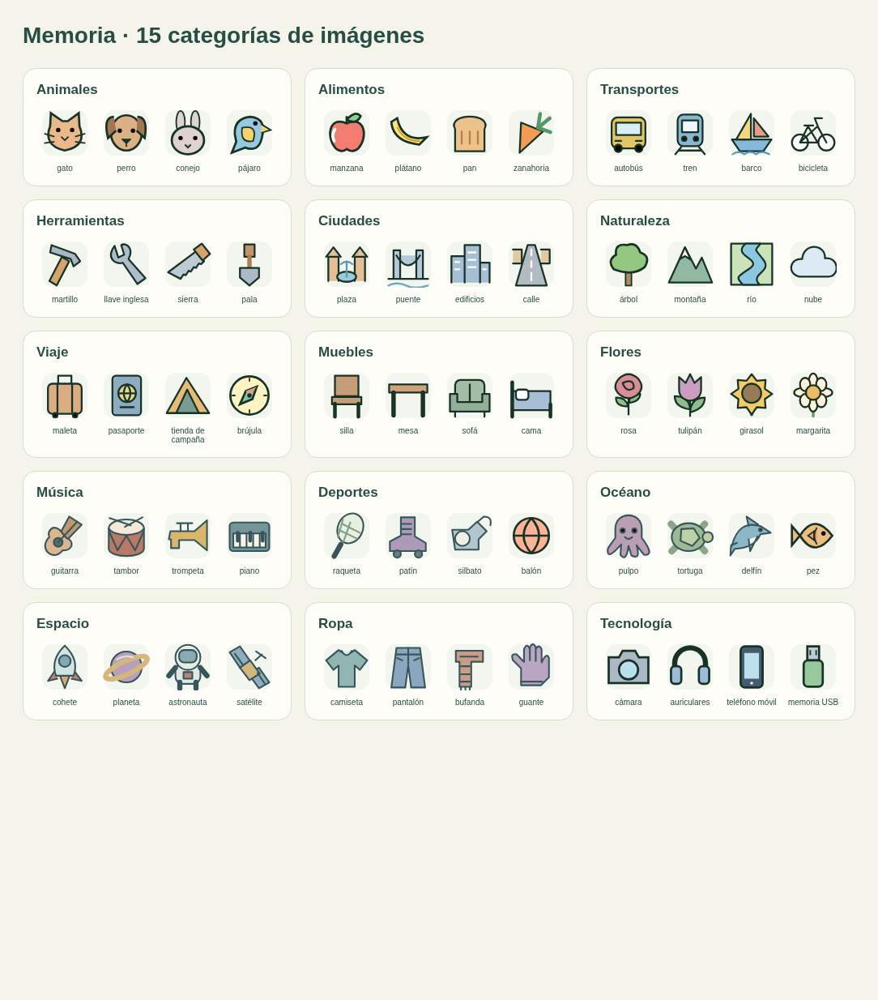

# Iteración de variedad, dificultad y presentación

20 de octubre de 2026. Rama `improve/varied-mechanics-progression`, basada en el merge `e18cedf` de `desarrollo`.

## Qué cambia

**Memoria.** Se amplía de 9 a 15 categorías: se añaden música, deportes, océano, espacio, ropa y tecnología. Son 60 imágenes categorizadas, además del material funcional que ya existía. Los SVG comparten fondos suaves, trazos redondeados y una paleta más uniforme; Word utiliza PNG generados de esos mismos vectores. Las etiquetas siguen sin artículos.

Todas las secuencias comienzan con cinco estímulos en nivel 1. En 6–10 años progresan a seis y siete; en 10–18, a siete y nueve. Se mantienen el recuerdo inverso y la actualización de los últimos elementos donde ya estaban previstos. En posiciones alternan la respuesta sobre una cuadrícula vacía y la respuesta con fila/columna; ambas corrigen la misma posición original. Están disponibles en los niveles 1 y 2.

Se añaden escenas del estudio que desaparecen antes de preguntar por un objeto y mapas del barrio para reconstruir las visitas. Los edificios mantienen sus posiciones entre recorridos. En el nivel 3 de los grupos mayores puede pedirse el recorrido inverso. Las imágenes también se incluyen en las fichas Word, junto con los datos de la fuente.

[Escena](review-assets/varied-mechanics/memory-scene.png) · [Mapa](review-assets/varied-mechanics/memory-route.png)

**Velocidad de procesamiento.** Cuatro mecánicas nuevas: búsqueda de un símbolo, revisión de parejas, selección de la flecha central ignorando distractores y traducción de secuencias mediante una clave. En el nivel superior de flechas se pide la dirección contraria. Aumentan la longitud, los distractores, las parejas a revisar o los códigos a traducir según el nivel y la edad. Las tareas de categorías ahora muestran grupos mayores en niveles superiores, y las coincidencias exactas ofrecen más alternativas próximas.

La medición sigue comenzando al mostrar el estímulo. Se conservan las teclas numéricas, la práctica sin medición, la exclusión de tiempos al salir de la ventana y la posición estable de los controles tras responder. Los resultados del formato anterior se conservan por separado: la revisión nueva de Velocidad es la 4.

**Funciones ejecutivas.** Se añaden proyectos según edad: cómics y canciones, juegos de pistas, torneos, vídeos de ciencia, robótica, pódcasts, aplicaciones y exposiciones. Las tareas nuevas trabajan dependencias entre acciones, elección de recursos con condiciones, comprobación del tiempo disponible y cambio de prioridades. Las condiciones se expresan en el texto y las tablas; se comprueba que exista una respuesta correcta única en los planes de recursos.

**Lenguaje.** El modo Gramática recibe un banco propio con concordancia verbal y del adjetivo, construcción de oraciones, tiempos verbales, referencias, revisión de frases, conectores y estructuras de mayor complejidad. El orden de fragmentos se mantiene en Gramática cuando ese es el objetivo. Ortografía, vocabulario y composición conservan sus rutas. Las consignas especifican el tiempo verbal solicitado para evitar que un presente con sentido de futuro también parezca una respuesta válida.

**Matemáticas.** Las rutas de 8–18 años utilizan bancos con progresión explícita. En los grupos menores aumentan los operandos y aparecen operaciones encadenadas y repartos con sobrante. En los mayores se incorporan ecuaciones con paréntesis y términos en ambos miembros, cambios porcentuales sucesivos, proporciones no enteras, probabilidades sin reposición y superficies compuestas o recortadas. Las respuestas se comprueban con sus operaciones; las pruebas verifican también que las ecuaciones mostradas se cumplan. El cálculo con material concreto de 6–7 se mantiene.

**Documentos y Progreso.** Se elimina el subtítulo redundante bajo los documentos, conservando el enlace para ampliarlos, la transcripción y las explicaciones necesarias sobre monedas extranjeras. Desaparece «Cobertura de bancos». Progreso muestra anillos de aciertos y una gráfica por sesiones con una tabla accesible de datos. Utiliza el historial guardado de cada perfil; no mezcla usuarios ni inventa resultados.

[Progreso en escritorio](review-assets/varied-mechanics/progress.png) · [Progreso en móvil](review-assets/varied-mechanics/progress-mobile.png). Las capturas usan perfiles y resultados de prueba.

## Variedad comprobada

Comparación del banco de 16–18 años, nivel 1, antes y después. Se cuentan materiales distintos mediante la firma semántica del selector real, no por cambios de ID. Las cifras describen este grupo y nivel; no son una suma de toda la plataforma.

| Área | Materiales distintos antes | Después | Familias antes → después |
| --- | ---: | ---: | ---: |
| Memoria | 312 | 672 | 6 → 8 |
| Velocidad | 147 | 288 | 10 → 14 |
| Funciones ejecutivas | 73 | 209 | 10 → 14 |

[Auditoría de las cinco edades](audits/varied-mechanics.json). Los bancos conservan la rotación y los controles de repetición. Un banco finito puede volver a utilizar materiales después de recorrerlos.

## Comprobaciones

- `npm test`: 147 pruebas, incluidos los nuevos contratos de escenas, mapas, selección espacial, dificultad, gramática y operaciones matemáticas.
- Pruebas Python: 9.
- Navegador: acceso y contraseña, sesiones de cinco edades, supervisión con respuestas correctas e incorrectas, práctica de escritura, documentos y recuerdo por categoría.
- `browser-varied-mechanics.py`: escena y mapa que desaparecen, secuencia de cinco imágenes, ambas respuestas espaciales, las cuatro mecánicas nuevas de Velocidad, Gramática, Matemáticas, gráficas con resultados conocidos de tres sesiones y dos Word dentro de un ZIP. Verifica que los PNG de la escena y el mapa estén realmente incluidos.
- `browser-curriculum.py`: 138 actividades respondidas, 10 DOCX reales, cinco edades, persistencia, escritorio/móvil y mediciones válidas, inválidas y sin cronómetro.

Las pruebas de navegador utilizan cuentas y servicios simulados con el código real del contenido. No se han enviado correos ni hecho cobros. No hay Microsoft Word instalado en el entorno: se comprueban la estructura, las relaciones, las imágenes y el contenido de los DOCX, pero su paginación final requiere abrirlos en Word.

La nueva prueba de navegador queda incorporada a GitHub Actions. La comprobación de Cloudflare también compara `activity-model.js` y `content-policy.js`, necesarios para esta iteración.

## Publicación y revisión

1. Crear la PR hacia `desarrollo` y esperar la comprobación automática en verde.
2. Confirmar el merge. Esperar a que finalice **publicar**: actualiza Supabase y después la beta de Cloudflare.
3. Abrir `https://pruebas.learning-hub-5n9.pages.dev` y recargar con **Ctrl+F5**.
4. Probar Memoria y Velocidad en niveles 1 y 3; posiciones en niveles 1 y 2; comparar Gramática y Matemáticas entre niveles; descargar una ficha mixta y abrirla en Word.

La vista previa de una rama utiliza la función de Supabase ya publicada. Los nuevos bancos del servidor estarán disponibles cuando termine la publicación tras el merge; que la vista previa de Cloudflare se abra no acredita por sí solo esa actualización.

Se mantienen el flujo de publicación existente, las cuentas, los perfiles, el historial, la recuperación de contraseña y los controles de acceso y cuota. No se han añadido servicios ni credenciales.
